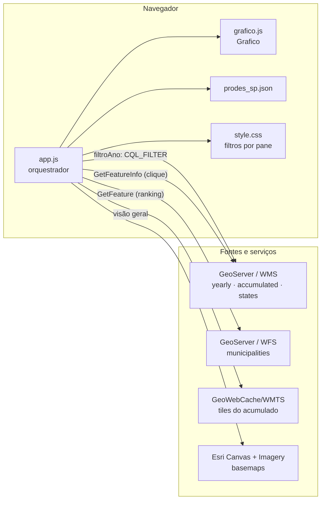
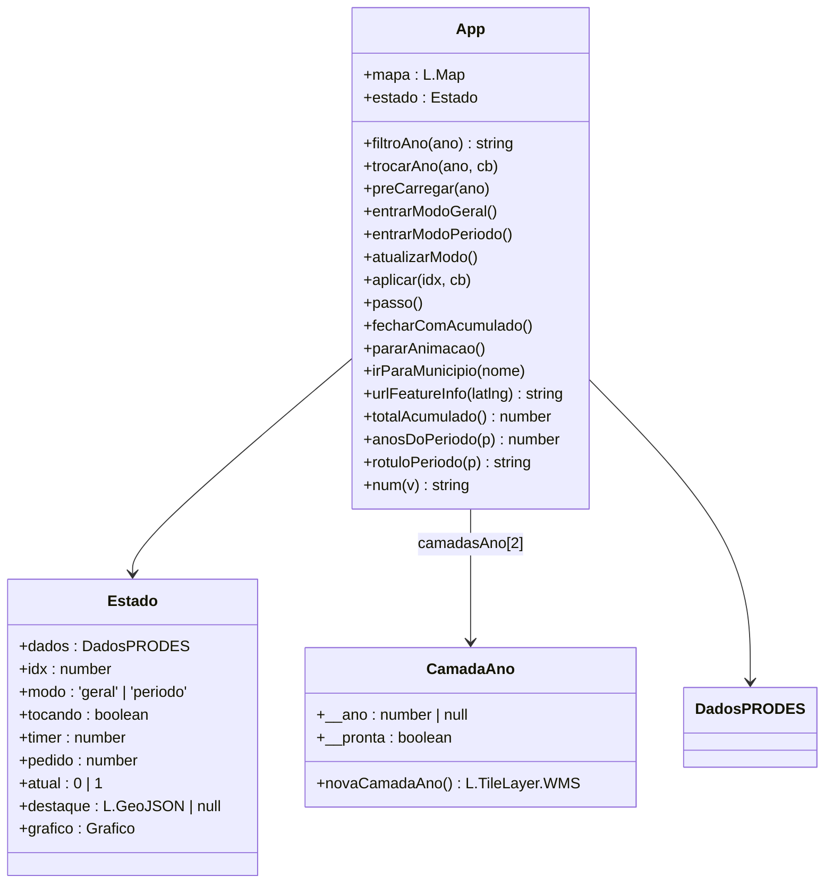
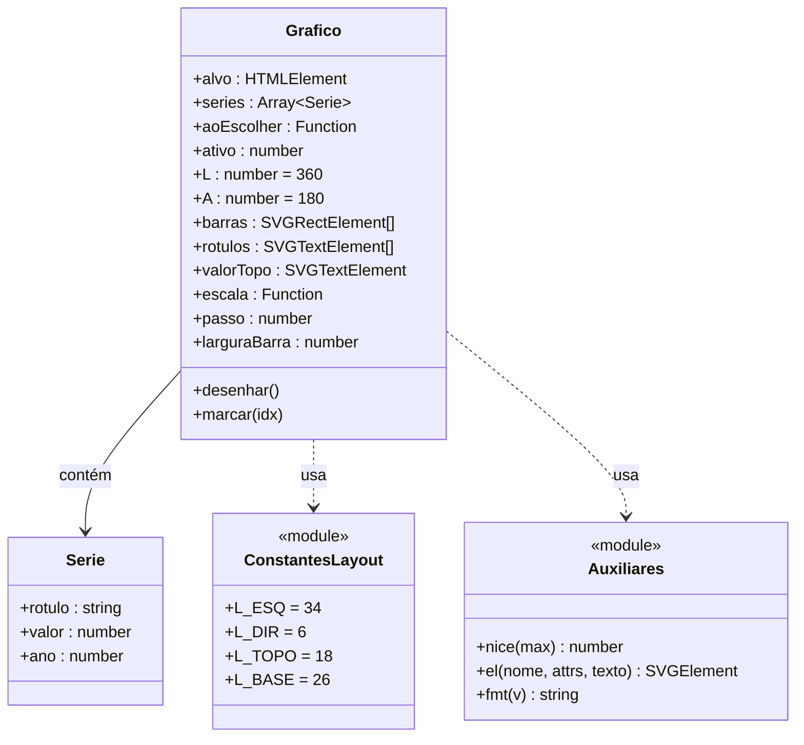
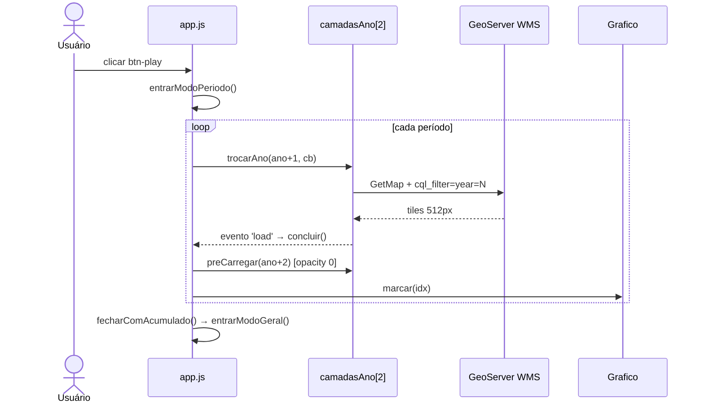
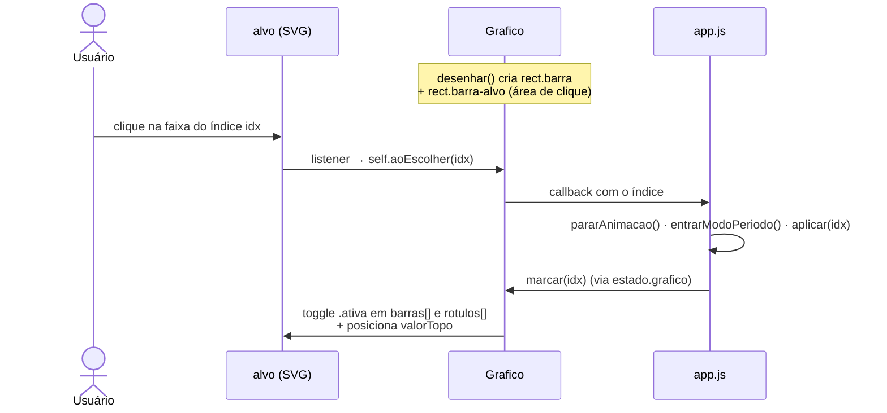
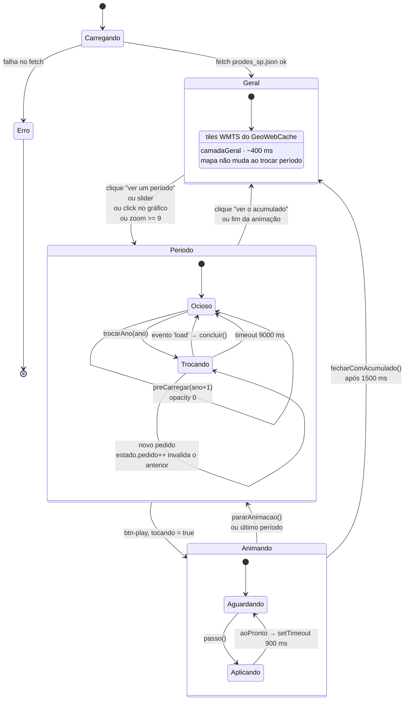
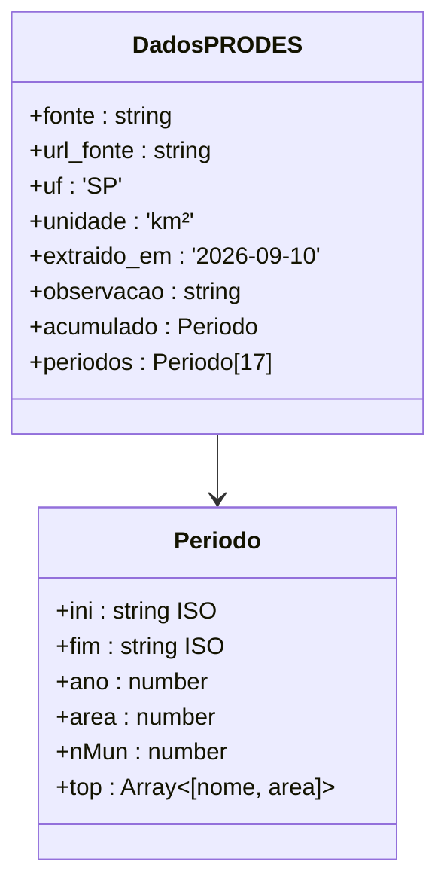

# Diagramas da aplicação

Modelagem do mapa web de desmatamento da Mata Atlântica paulista (PRODES / INPE),
derivada da leitura de `docs/assets/js/app.js`, `docs/assets/js/grafico.js` e do
arquivo de dados `docs/dados/prodes_sp.json`.

O repositório usa **JavaScript clássico de navegador**: os dois scripts são IIFEs
com `'use strict'` que penduram seu resultado em `window`. Não há módulos ES nem
classes exportadas — por isso os diagramas descrevem o escopo fechado e o objeto
`estado`, e não uma API pública de objetos.

> **Escopo da modelagem.** Derivada de `app.js`, `grafico.js` e `prodes_sp.json`.
> `style.css`, `Dockerfile` e `docker-compose.yml` não foram lidos, então a
> estilização por pane e o empacotamento não aparecem aqui.

## Índice

- [1. Componentes](#1-componentes)
- [2. Classes — app.js](#2-classes--appjs)
- [3. Classes — grafico.js](#3-classes--graficojs)
- [4. Sequência — animação da linha do tempo](#4-sequência--animação-da-linha-do-tempo)
- [5. Sequência — clique numa barra do gráfico](#5-sequência--clique-numa-barra-do-gráfico)
- [6. Estado da aplicação](#6-estado-da-aplicação)
- [7. Modelo de dados](#7-modelo-de-dados)

## 1. Componentes

Constantes de serviço declaradas no topo de `app.js`:

| Constante | Valor |
|---|---|
| `WMS` | `…/prodes-mata-atlantica-nb/wms` |
| `OWS` | `…/prodes-mata-atlantica-nb/ows` |
| `CAMADA_ANO` | `prodes-mata-atlantica-nb:yearly_deforestation` |
| `CAMADA_ACUM` | `prodes-mata-atlantica-nb:accumulated_deforestation_2000` |
| `CAMADA_UF` | `prodes-mata-atlantica-nb:states_mata_atlantica_biome` |
| `CAMADA_MUN` | `prodes-mata-atlantica-nb:municipalities_mata_atlantica_biome` |

## 2. Classes — app.js

> Não existe uma classe `App`: o arquivo é uma IIFE com um único escopo fechado.
> A classe acima é uma abstração das funções reais declaradas nesse escopo, listada
> para dar forma ao conjunto.

Decisões de projeto visíveis no código:

- **Panes numerados.** Cada camada ganha um pane com `zIndex = 410 + i * 8`. Motivo
  declarado em comentário: o GeoServer do TerraBrasilis ignora `SLD_BODY`, então a
  correção cromática é feita no cliente com filtros CSS em `style.css`.
- **Buffer duplo.** `camadasAno = [novaCamadaAno(), novaCamadaAno()]` — a nova camada
  só entra depois de carregada, e só então a antiga sai. É o mecanismo anti-pisca.
- **Token de invalidação.** `estado.pedido` é incrementado em `trocarAno`; a conclusão
  é descartada se `meu !== estado.pedido`. Torna seguro arrastar o slider rapidamente.
- **Válvula de escape.** `setTimeout(concluir, 9000)` impede que rede lenta ou tile
  com erro travem a animação.
- **Tile escolhido por medição.** Comentário no código registra: 24 tiles de 256 px =
  1290 ms; 6 tiles de 512 px = 930 ms; 1 imagem única = 2470 ms. Daí `tileSize: 512`.

## 3. Classes — grafico.js

Notas:

- O `Grafico` **não se atualiza sozinho**. Quem chama `marcar(idx)` é o `aplicar()` do
  `app.js`, via `estado.grafico.marcar(idx)`. O gráfico é reativo ao estado global.
- A **área de clique é um `<rect class="barra-alvo">` separado** da barra, para não
  depender da espessura desta.
- Existem **duas formatações numéricas paralelas**: `fmt` (exportado como
  `global.fmtNum`) e `num()` dentro de `app.js`, que usa `toLocaleString('pt-BR')`.
  As regras de uma não valem para a outra.
- O gráfico é desenhado **sem biblioteca**: `nice()` arredonda o topo da escala,
  `el()` cria elementos SVG via `createElementNS`.
- As `series` são montadas em `app.js` já com o **valor médio anual**
  (`p.area / anosDoPeriodo(p)`), e não com a área bruta do período.

## 4. Sequência — animação da linha do tempo

O `preCarregar` é invisível (`opacity: 0`) e busca o **próximo** período enquanto o
atual está na tela. Quando chega a hora de avançar, os tiles já estão no navegador.

## 5. Sequência — clique numa barra do gráfico

## 6. Estado da aplicação

O núcleo real do sistema é o objeto `estado`, com os campos que funcionam como
máquina de estados. As guardas:

| Campo | Papel |
|---|---|
| `pedido` | Contador incremental. Descarta conclusões de trocas já superadas. |
| `atual` | Alterna 0/1, escolhendo qual das duas camadas é visível. |
| `tocando` + `timer` | `pararAnimacao()` limpa o timer e derruba a flag. |
| `destaque` | Guarda o `L.geoJSON` do município; removido pelo botão voltar. |
| `modo` | `'geral'` ou `'periodo'` — decide se o mapa troca ou só o painel. |

Ponto delicado: **`entrarModoGeral()` incrementa `estado.pedido`** apenas para
invalidar uma troca de período em andamento. É a transição que cruza as duas
máquinas de estado.

## 7. Modelo de dados

`docs/dados/prodes_sp.json` traz 17 períodos PRODES e um bloco `acumulado`.

### Dois campos chamados "ano"

O objeto `Periodo` carrega **duas noções distintas de ano**, e confundi-las é o erro
mais fácil de cometer neste projeto:

| Campo | Significado | Exemplo (1º período) |
|---|---|---|
| `ini` / `fim` | Janela de mapeamento (1º ago → 31 jul) | `2000-08-01` → `2004-07-31` |
| `ano` | **Ano PRODES**, o rótulo de fim do período | `2004` |

O `rotuloPeriodo()` usa `ini` e `fim` (`"ago/2000 — jul/2004"`), enquanto o
`filtroAno()` do WMS usa `year=` com `p.ano` (`year=2004`). O mesmo objeto alimenta
as duas coisas com valores diferentes — e está correto, porque o GeoServer indexa
os polígonos pelo ano PRODES.

### `acumulado` não é o acumulado de 2000

O campo `acumulado.area` vale **154 090,22 km²**, mas sua janela é
`ini: "1500-08-10"` → `fim: "2000-07-31"`. Ou seja: não é a soma dos períodos
exibidos, é o estoque histórico de supressão acumulado entre 1500 e 2000.

A aplicação usa esse número no aviso "antes do início do monitoramento anual", o que
está coerente com o dado. Já `totalAcumulado()` — a função que soma os 17 `area` de
`periodos` — dá cerca de **2 760 km²**. São grandezas de ordens de magnitude
diferentes, e ambas aparecem na interface.

### Períodos plurianuais

Só alguns períodos cobrem um único ano. Os primeiros são bienais ou quadrienais
(2000–2004, 2004–2006, 2011–2013, 2014–2016). Por isso a interface e o gráfico
trabalham com **média anual** (`p.area / anosDoPeriodo(p)`), e não com a área bruta:
comparar um período de 4 anos com um de 1 ano pelo total seria enganoso.

---

## Como manter este arquivo

Os diagramas estão em **Mermaid**, texto puro. O GitHub renderiza nativamente em
`.md` — não é preciso exportar imagem.

Para editar: altere o bloco Mermaid correspondente no texto. Para gerar imagem
(Word, slide, draw.io), exporte **SVG** a partir de uma ferramenta que renderize
Mermaid, e não PNG rasterizado direto — assim a imagem mantém resolução.

O `diagram_desm_sp.png` na raiz do repositório continua servindo de visão geral
para quem abre o projeto sem ler código.
